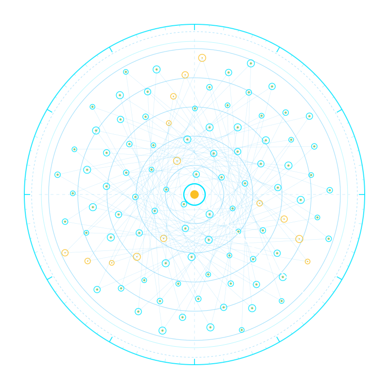

# 📱 Argus — Zero-Cloud Smart TV & Media Controller

<div align="center">

[-10B981?style=for-the-badge&logo=android&logoColor=black)](https://github.com/rmediatech/argus-tv/releases/download/v1.3.5/argus-v1.3.5.apk)
[](CHANGELOG.md)
[](https://rmediatech.com)
[](https://rmediatech.com)

</div>

<p align="center">
  
</p>

> **Platform:** 100% Native Android (Kotlin + Jetpack Compose)  
> **Privacy Invariant:** Zero Cloud, Zero Tracking, Zero Ads. All commands execute locally on your LAN.  
> **Latency:** $<5\text{ ms}$ direct microsecond response over local Wi-Fi.  
> **Developer:** Crafted by RMediaTech ([rmediatech.com](https://rmediatech.com))  

---

## 📥 Direct Android APK Download & Installation (Zero Play Store Gatekeeping)

Because **Argus** contains zero Google Play Services telemetry, zero ad SDKs, and zero cloud tracking, we distribute the cryptographically signed `.apk` **directly from our Sovereign Binary Vault**—bypassing Google Play Store gatekeeping entirely:

### Option A: Direct Phone Browser Download (30 Seconds)
1. On your Android phone, open your browser and visit **[https://rmediatech.com/downloads](https://rmediatech.com/downloads)** (or tap **[Direct Download `argus.apk`](https://rmediatech.com/bin/argus.apk)**).
2. Open the downloaded `argus.apk` file. If prompted by Android, toggle **"Allow from this source"** (standard Android prompt for apps installed outside the Play Store) and tap **Install**.

### Option B: Terminal / Workstation Verification & ADB Install
```bash
# 1. Download the signed APK, SHA-256 checksum, and OpenPGP signature
curl -sSL https://rmediatech.com/bin/argus.apk -o argus.apk
curl -sSL https://rmediatech.com/signatures/argus.apk -o argus.apk.asc
curl -sSL https://rmediatech.com/SOVEREIGN_RELEASE_KEY.asc | gpg --import

# 2. Verify cryptographic provenance (Key: 6BC8 DA5E 7F1B 8B49 BE5C D70A 4E42 8019 A109 578B)
gpg --verify argus.apk.asc argus.apk
echo "2793dbc489993e7376fa5ff19c14e8e2e32c2044d734c24fd31047268055902b  argus.apk" | sha256sum -c -

# 3. Install directly to your connected Android phone
adb install -r argus.apk
```

* 📖 **Full Documentation & Cinema Guide**: [docs/CINEMA_WATCH_PARTY.md](docs/CINEMA_WATCH_PARTY.md)
* 📜 **Engineer-to-Engineer Changelog**: [CHANGELOG.md](CHANGELOG.md)

---

## 🏛️ Mythological Lineage & Geometric Rationale

* **The Hundred-Eyed Guardian**: In Hellenic myth, **Argus Panoptes** (*Ἄργος Πανόπτης* — "the all-seeing") was the titan sentinel of Argos with one hundred unblinking eyes. With some eyes resting while the rest watched the horizons, surprise incursions were physically impossible.
* **Sovereign Architectural Role**: In our mobile and media fleet, **`argus`** oversees smart television hardware and streaming displays with 100% local, peer-to-peer autonomy. It operates silently over your local LAN, discovering media devices via SSDP multicast and ARP sweeps with zero external cloud mediation.
* **Mathematical Crest Geometry**: Generated purely from mathematical parametric equations on a transparent background, the emblem features 100 all-seeing eyes distributed via a **Fibonacci Phyllotaxis Spiral** ($r = c\sqrt{n}, \theta = n \times 137.507764^\circ$) matching golden-ratio botanical spirals, framed by concentric polar radar range rings ($r = 60, 120, 180, 240, 300$), a $42^\circ$ active radar sweep beam, and a central Panoptes focal core.  

---

## 🌟 Overview

**Argus** (named after *Argus Panoptes*, the all-seeing guardian of classical Greek lore) is a sleek, lightweight, tactical native Android remote controller built for smart TVs and network media players (Google TV, Android TV, Fire TV, Roku, Samsung Tizen, LG webOS, Sony BRAVIA, Vizio SmartCast, and Wake-on-LAN hosts). 

Unlike commercial remote apps from the Google Play Store that demand account logins, track your viewing history, and bombard you with advertisements, Argus communicates **directly with your TV over your local home Wi-Fi network**.

---

## 🚀 Key Features

* **⚡ Ultra-Low Latency:** Sends local commands directly to your TV in microseconds without touching the public internet.
* **🔍 Auto-Discovery (SSDP & ARP):** Automatically scans your Wi-Fi subnet using UDP multicast (`239.255.255.250:1900`) and TCP protocol probing.
* **🎯 Manual IP Override:** Supports direct IP entry if your Wi-Fi router blocks multicast/broadcast packets between client devices.
* **🎛️ Full Tactical D-Pad & Controls:**
  * Power On/Off (with Wake-on-LAN fallback)
  * Directional D-Pad (Up, Down, Left, Right, Select/OK)
  * Volume Up, Volume Down, Instant Mute
  * Back, Home, and Options / Quick Settings keys
  * Play, Pause, Rewind, Fast-Forward
* **🎬 Sovereign Cinema Beam & Now Playing:**
  * Real-time non-DRM hardware playback observation and timecode playhead calculation.
  * Interactive Cinema Beam dialog for live watch-session tracking, URL beam, and multi-room sync.
  * Dedicated interactive volume and playback scrub HUD bar.
  * Complete instructions in [docs/CINEMA_WATCH_PARTY.md](docs/CINEMA_WATCH_PARTY.md).
* **📳 Haptic Feedback:** High-frequency tactile vibration on every button press for physical remote tactile feel.
* **🖤 Pure Dark Tactical Theme:** AMOLED-optimized deep black with electric cyan and tactical accents.
* **🗑️ Sovereign Device Governance:** Red trashcan to permanently forget unwanted network devices, plus an eye toggle to hide/unhide TVs.

---

## 🎬 Sovereign Cinema Beam & Multi-Room Watch Party (v1.3.5)

Argus features the **Sovereign Cinema Engine** — direct hardware playback observation, source-agnostic mobile-to-TV keyboard beaming, and zero-cloud multi-TV watch party lockstep synchronization:

```text
┌────────────────────────────────────────────────────────┐
│ SOVEREIGN CINEMA & WATCH PARTY          Quick Steps ℹ️ │
│ 🛡️ LOCKSTEP D-PAD & MEDIA PARITY ACTIVE [2 SCREENS]    │
├────────────────────────────────────────────────────────┤
│ YouTube • PLAYING                                      │
│ Sovereign Living Room Fleet Cinema [4K Ultra HD]       │
│ Hardware Playhead: 00:24:12 (1452000 ms) • Speed 1.0x  │
├────────────────────────────────────────────────────────┤
│ BEAM STREAM / LIVE GUIDE (SOURCE AGNOSTIC)             │
│ [ YouTube | Pluto TV | Prime Video | Direct HLS      ] │
│ [ Search Title or Direct Video URL                   ] │
│ [              BEAM STRAIGHT TO TV                   ] │
├────────────────────────────────────────────────────────┤
│ MULTI-TV WATCH PARTY SYNC (LOCKSTEP FANOUT)            │
│ • Living Room TV (192.168.1.186)              [LEADER] │
│ • Bedroom TV (192.168.1.158)                  [SYNCED] │
│                                                        │
│ [🛑 STOP PARTY & RETURN ALL SCREENS TO HOME LAUNCHER ] │
└────────────────────────────────────────────────────────┘
```

### 1. Universal Control Parity Across All Party TVs
* **100% Lockstep Navigation**: In Watch Party mode, directional navigation (`UP`, `DOWN`, `LEFT`, `RIGHT`, `SELECT`, `BACK`, `HOME`), transport keys (`PLAY_PAUSE`, `PLAY`, `PAUSE`, `REWIND`, `FAST_FORWARD`), and acoustic commands (`VOLUME_UP`, `VOLUME_DOWN`, `MUTE`) broadcast to all linked displays in parallel lockstep.
* **Source-Adaptive Beam Planning**:
  * **On-Demand Video (YouTube)**: Resolves canonical video URIs and dispatches direct view intents across all screens.
  * **Linear Live TV & EPG Guides (Pluto TV)**: Launches directly into the electronic program guide (`SplashActivity`), allowing simultaneous channel surfing across all displays with the shared D-pad.
  * **Direct Streams (HLS / MP4)**: Direct MIME-typed broadcast to native video renderers.
* **Seamless Unicast Fallback**: As soon as the Watch Party ends (via **STOP PARTY** or clearing followers), remote controls instantly revert to strict single-device unicast routing on the currently selected TV with zero cross-network leakage.

### 2. Microsecond Sub-10ms Persistent Multiplexing
* **Dual-Engine ADB Shell Multiplexing**: Both Amazon Fire TV and Google TV utilize persistent interactive `AdbShellStream` instances over port 5555. Bypasses repetitive socket handshakes, cutting key dispatch latency from $500\text{--}870\text{ms}$ down to $<10\text{ms}$.
* **Two-Attempt Socket Self-Healing**: Automatically catches stale or dropped ADB sockets during long movie playbacks, evicts dead TCP descriptors, reconnects in milliseconds, and retries the command transparently without dropping user inputs.

### 3. Non-DRM Hardware Playhead Telemetry & Auto-Healing
* **Android 11+ Symbolic State Parsing**: Decodes both classic numeric state codes (`state=3`) and modern symbolic strings (`state=PLAYING(3)`, `state=PAUSED(2)`) directly from `dumpsys media_session`.
* **Zero-Speed Idle Defense**: Reclassifies zero-velocity states (`state=3, position=0, speed=0.0`) as `BUFFERING` to prevent false playback reports while video buffers.
* **Auto-Healing Sentinel**: Classifies playhead drift mathematically (Green $<500\text{ms}$, Yellow $500\text{--}2500\text{ms}$, Red $>2500\text{ms}$) with cooldown anti-flapping guardrails, applying sub-perceptual slipstream micro-pauses strictly when both displays are playing the same title.
* **Unified Teardown**: Halts playback on all linked displays simultaneously with concurrent `PAUSE` + `HOME` dispatches, restores factory sleep policies, and resets telemetry leases in unison.

---

## 📺 First-Time Smart TV Pairing Guide (By Brand)

To protect your privacy and TV security, modern smart TV operating systems require a **one-time physical authorization** when a new remote app connects over Wi-Fi. Once allowed, Argus reconnects automatically with zero prompts:

| TV Platform / Brand | Port | First-Time TV Screen Prompt | Action Required |
| :--- | :--- | :--- | :--- |
| **Amazon Fire TV** | `5555` | *"Allow USB debugging? RSA fingerprint: ... [✓] Always allow"* | Check **"Always allow"** and click **OK** with your TV remote. |
| **Google TV / Android TV** | `5555` / `8008` | *"Allow USB debugging? [✓] Always allow"* | Check **"Always allow"** and click **OK**. (Port 8008 DIAL fallback). |
| **Roku TV & Streaming Sticks** | `8060` | *None (Instant Connect)* | Zero prompts needed. Connects instantly over local ECP. |
| **Samsung Smart TV (Tizen)** | `8001` / `8002` | *"Allow ArgusRemote to control this TV? [Allow / Deny]"* | Click **Allow** using your TV's physical buttons or remote. |
| **LG webOS TV** | `3000` / `3001` | *"com.rmediatech.sovereignremote requests permission [Accept]"* | Click **Accept** on the TV screen. |
| **Sony BRAVIA** | `80` / `20060` | Direct IRCC SOAP API | Pre-shared key or instant IRCC command execution. |
| **Vizio SmartCast** | `7345` / `9000` | HTTPS Direct API | Connects over local SSL socket. |

---

## 🛠️ Build & Installation (No Android Studio Required!)

This project is built using the standard command line and Gradle wrapper:

### 1. Prerequisites
* **JDK 17 or JDK 21 LTS**
* **Android SDK** (Build-Tools `34.0.0` and Platform `android-34`)
* **ADB** (`android-tools-adb`)

### 2. Fast Commands (Makefile)

```bash
# Compile the debug APK
make build

# Install APK to connected phone (via USB or Wi-Fi)
make install

# Launch the app on your phone
make run

# Stream real-time app logs
make logs
```

---

## 📲 Connecting Your Phone via ADB

### Method A: Via USB Cable (Simplest)
1. On your Android phone, go to **Settings $\to$ About Phone** and tap **Build Number** 7 times to enable **Developer Options**.
2. Go to **Settings $\to$ System $\to$ Developer Options** and enable **USB Debugging**.
3. Plug your phone into your computer with a USB cable.
4. Run `make devices`.
5. Tap **"Allow USB Debugging"** on your phone's screen.
6. Run `make run` — the app builds, installs, and launches automatically!

### Method B: Wireless Debugging (Android 11+)
1. Ensure your phone and computer are on the same Wi-Fi network.
2. In **Developer Options**, enable **Wireless Debugging**.
3. Tap **"Pair device with pairing code"** to view the IP, Port, and 6-digit code.
4. Run:
   ```bash
   adb pair <phone_ip>:<port> <pairing_code>
   adb connect <phone_ip>:<connect_port>
   ```
5. Run `make run`.

---

## 🏛️ Architecture

Argus adheres strictly to the Sovereign Engineering Standard: single-responsibility modularity, zero monolithic sprawl, and zero public cloud dependencies.

```
app/src/main/java/com/rmediatech/sovereignremote/
├── MainActivity.kt                # Thin lifecycle shell (<= 80 lines)
├── model/
│   ├── RemoteDevice.kt            # Immutable device models, RemoteKey & liveness enums
│   └── NowPlayingState.kt         # Live playback state, playhead timecodes & media metadata
├── net/
│   ├── NetworkEnvironmentManager.kt # Dynamic CIDR, active subnet resolution & hardware ID
│   └── WakeOnLan.kt              # Kernel ARP cache parser & magic packet broadcaster
├── discovery/
│   ├── UniversalTvScanner.kt      # Parallel SSDP multicast, ARP cache & TCP sweep engine
│   └── SmartTvClassifier.kt       # IEEE MAC OUI and deep port heuristic classifier
├── protocols/
│   ├── TvProtocolRegistry.kt      # Agnostic protocol router with auto-promotion
│   ├── TvMediaBridge.kt           # Non-DRM hardware playback observer & playhead calculator
│   ├── FireTvProtocol.kt          # Persistent Toybox stream (<1ms) & ADB fallback
│   ├── GoogleTvProtocol.kt        # Direct ADB keyevent + DIAL app launcher
│   ├── RokuProtocol.kt            # Local ECP HTTP/REST wire dispatcher
│   ├── SamsungProtocol.kt         # Tizen WebSocket JSON frame engine
│   ├── LgWebOsProtocol.kt         # webOS SSAP WebSocket handshake & key dispatcher
│   ├── SonyBraviaProtocol.kt      # SOAP IRCC XML envelope dispatcher
│   └── VizioSmartCastProtocol.kt  # SmartCast HTTPS command dispatcher
├── state/
│   ├── ArgusSessionState.kt       # Multi-network state, device blacklist & liveness tracker
│   ├── ArgusMediaCoordinator.kt   # Live media coordinator & playhead updater
│   └── DeviceLivenessTracker.kt   # Non-blocking background health probe
└── ui/
    ├── theme/                     # Tactical dark AMOLED palette & theme presets
    └── components/
        ├── RemoteScreen.kt        # Primary remote command surface
        ├── CinemaBeamDialog.kt    # Sovereign Cinema Beam & live playhead modal
        ├── PlaybackVolumeBar.kt   # Reactive volume & playback transport bar
        ├── DeviceSelectionDialog.kt # Scoped network picker, trashcan & hide drawers
        ├── ControllerLayouts.kt   # Tactical D-Pad, Scandi frosted glass & retro pads
        ├── DiagnosticLogsDialog.kt # Live forensic audit log viewer
        └── AboutArgusDialog.kt    # Tactical credentials & pairing guidance
```
